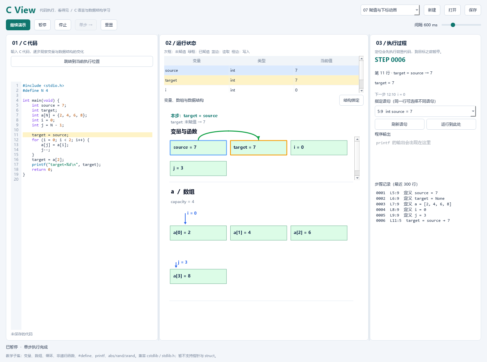

# C View · C 语言与数据结构可视化

C View 是一款中文桌面教学程序，帮助你通过代码执行过程学习 C 语言和数据结构。自由输入代码，在同一次演示中观察变量、运算、条件、循环、数组、单链表、顺序表、栈和循环队列。



[查看动画演示](docs/animation.gif)

- 完整演示、暂停、继续、停止和单步执行。
- 点击行号旁的播放按钮，单独观察该语句的执行。
- 变量和数组用灰色、绿色方框区分未赋值与已赋值状态。
- 绿色箭头展示赋值传递，下标箭头随循环变量平滑移动。
- 非递归函数支持快速调用动画和展开内部演示。
- 红色箭头标记指针指向的变量或数组元素，支持取地址、解引用和数组遍历。
- `typedef` 类型别名和结构体，支持成员访问、复制和结构体指针。
- 标准单链表节点自动识别，以红色节点和单向箭头演示创建、插入、删除及遍历。
- 标准结构体顺序栈自动识别，以单行红色元素框、蓝色外框及指针移动演示入栈和出栈。
- 内置十六个由浅入深的可编辑示例，支持保存代码和数据结构显示配置。

目前支持教学常用的 C 语言子集，具体范围见下文。

## 安装与启动

首次安装需要联网；安装后可以离线使用，不需要安装 C 编译器。建议使用 Python 3.12，最低要求 Python 3.10。

### 获取项目

推荐使用 Git。在准备存放项目的目录打开终端，执行：

```bash
git clone https://github.com/HONORE-YYC/C-View.git
cd C-View
```

克隆后的 `C-View` 文件夹包含 `main.py` 和 `requirements.txt`。下面以 Windows 路径 `D:\Projects\C-View` 为例，请替换为自己的实际路径。

未安装 Git 的用户，也可以在本仓库页面选择 **Code → Download ZIP**，解压后进入包含 `main.py` 的文件夹。

### 方案一：使用 Anaconda

打开 **Anaconda Prompt**，首次使用依次执行：

```bat
conda create -n c-view python=3.12 pip -y
conda activate c-view
cd /d "D:\Projects\C-View"
python -m pip install -r requirements.txt
python main.py
```

以后启动时，在 Anaconda Prompt 中执行：

```bat
conda activate c-view
cd /d "D:\Projects\C-View"
python main.py
```

也可以在 Anaconda Prompt 中进入项目文件夹后，用一条命令指定环境启动：

```bat
conda run -n c-view --no-capture-output python main.py
```

macOS / Linux 用户可在能够使用 `conda` 的终端执行同样的环境创建、安装和启动命令，将 `cd /d` 换成 `cd`，并使用实际的项目路径。

### 方案二：使用已安装的 Python

Windows 用户在项目文件夹打开 PowerShell，执行：

```powershell
python -m venv .venv
.\.venv\Scripts\python.exe -m pip install -r requirements.txt
.\.venv\Scripts\python.exe main.py
```

以后进入项目文件夹，执行最后一条命令即可启动。

macOS / Linux：

```bash
python3 -m venv .venv
.venv/bin/python -m pip install -r requirements.txt
.venv/bin/python main.py
```

以后进入项目文件夹，执行 `.venv/bin/python main.py` 即可启动。

## 开始使用

启动后代码区为空白，不会自动加载示例。可以直接输入代码、打开已有文件，或从顶部菜单导入示例和标准模板。

1. 从右上角选择示例，或输入自己的 C 代码。主题按钮旁的“标准模板”提供可被系统识别并进行特殊演示的代码，目前包含“单链表构建（头插法）”和“顺序栈构建（入栈与出栈）”。点击即可导入，之后可自由修改名称和操作。
2. 点击“单步”执行一步，或点击“完整演示”自动播放。黄色高亮标记当前执行的语句。
3. 点击“暂停”保留进度，随后可以继续或单步；点击“停止”保留画面并解锁代码，再次播放将从头开始。“重置”会清空画面。
4. 想单独观察某条语句时，将鼠标移到代码左侧的行号，行号会变为播放按钮。点击后，程序先执行必要的前置代码，再演示该语句；同一行有多条语句时可选择具体语句。也可以通过“指定语句”和“运行到此处”在目标之前暂停。
5. 点击“结构绑定”，选择数组的显示方式，并填写对应的长度、栈顶或队列下标变量名。同一个程序可同时显示多个数据结构。
6. 保存时会生成 `.c` 代码文件和同名 `.cview.json` 配置文件；再次打开代码时会自动读取配置。分享示例时请保留这两个文件。

运行和暂停期间不能编辑代码；停止或重置后可以修改。修改代码后，下次演示从头开始。播放速度可通过界面调整。

演示时，代码高亮会随执行更新，但不会自动滚动或移动你的光标。点击代码区上方的“跳转到当前执行位置”，可随时查看当前高亮语句，不改变执行进度。

中间面板为演示画布：左侧显示数组和数据结构，右侧从上到下依次排列结构体名、函数名和变量。两侧独立滚动，变量增减不会推移数组画面。内容超出显示范围时，可以在对应区域使用鼠标滚轮或拖动滚动条查看。

### 函数演示

已定义的函数以紫色函数名框显示在画布右侧的变量与函数栏。

- **完整演示或直接单步执行调用：** 显示紫色输入框、函数框和传递箭头；受调用影响的变量或数组单元短暂变紫，显示结果后恢复原色。
- **展开函数：** 单步到调用前，点击代码区上方的“展开函数演示”；如果继续点击“单步”，则使用快速调用动画。
- **点击调用行号：** 点击主函数中调用语句左侧的播放按钮，直接使用这次调用的实际参数展开函数。

展开期间，画面临时显示函数的参数、局部变量及相关全局变量，变量方框为紫色，普通赋值箭头仍为绿色。可以暂停、继续或单步观察；函数结束后恢复调用者画面并暂停。右上角“07 函数与数组参数”示例可演示这些操作。

[查看快速调用画面](docs/function-call.png) · [查看函数内部演示](docs/function-detail.png)

### 看懂可视化画面

| 显示 | 含义 |
| --- | --- |
| 灰色方框 | 已声明、尚未赋值，只显示变量名或数组元素名 |
| 绿色方框 | 已赋值，显示名称和值 |
| 蓝色边框 | 本步读取的单元 |
| 橙色边框 | 本步写入的单元 |
| 绿色动态箭头 | 从画面中的源变量或数组元素向目标传递值 |
| 数组上方的小箭头 | 标记 `a[i]`、`a[j]` 等下标变量当前指向的位置 |
| 红色小箭头 | 标记 `p` 等指针当前指向的变量或数组元素 |

常量赋值和同一单元的自更新不显示传递箭头。下标箭头支持直接变量及其自增、自减形式；`a[i+1]` 等复合下标可以执行，但不会生成对应的下标箭头。

数组单元是否为绿色表示它是否已有值，与它是否属于顺序表、栈或队列的有效元素无关。部分初始化的数组会按 C 规则将剩余元素补零，这些单元也会显示为绿色。

### 指针演示

选择“08 指针与取地址”示例，可以观察 `int *p = &x`、`*p = 7`、指针遍历数组以及指针参数。

[查看红色指针演示画面](docs/pointers.png)

- 指针变量显示可读的目标，如 `p = &values[1]`；红色小箭头标记目标，`p++` 时平滑移动。
- `*p` 读写的是目标单元；普通数值赋值仍使用绿色箭头，指针变量之间的地址复制使用红色箭头。
- 空指针显示 `NULL`，不指向任何方框。需要使用 `NULL` 时包含 `<stddef.h>`、`<stdio.h>` 或已支持的标准库头文件，也可写 `0`。
- 允许指针移动到数组最后一个元素之后的位置用于循环结束判断，标记为“尾后，不可解引用”；继续超出范围或读取尾后位置会报错。
- 指针参数按值传递，但通过 `*p` 可以修改原变量。函数展开时会显示指针及其可访问的目标。

指针使用教学用的对象地址表示，不显示操作系统的真实内存地址。可以通过结构体指针连接已声明的节点，也可用 `new/delete` 创建和释放结构体节点。

## 数据结构与示例

数据结构使用普通 C 数组和变量实现，通过“结构绑定”选择显示方式。

| 类型 | 需要绑定 | 约定 |
| --- | --- | --- |
| 普通数组 | 数组名 | 展示元素和物理下标 |
| 顺序表 | 数组名、长度变量 | 有效元素范围为 `[0, length)` |
| 栈 | 数组名、top 变量 | `top = -1` 为空栈；top 指向栈顶元素 |
| 循环队列 | 数组名、front、rear | front 指向下一个出队位置，rear 指向下一个入队位置，预留一个空位 |

容量为 N 的循环队列最多保存 N−1 个元素。队空条件为 `front == rear`，队满条件为 `(rear + 1) % N == front`。插入、删除和空满判断需要写在自己的 C 代码中。

内置示例：

| 示例 | 内容 |
| --- | --- |
| 01 变量、赋值与宏 | 未赋值状态、复制箭头、表达式宏、整数与小数 |
| 02 类型、const 与转换 | long long、bool、字符、数值转换与 const_cast 的安全边界 |
| 03 布尔判断与数学函数 | 距离计算、取整、短路判断与布尔结果动画 |
| 04 scanf 与 cin/cout 输入输出 | long long、double、char、字符数组、流式输出与交互输入 |
| 05 循环、数组与下标动画 | for、while、continue、元素复制与 i/j 下标移动 |
| 06 二维数组与叠层动画 | 行与列、元素抽出和复制、宽数组与相同行折叠 |
| 07 函数与数组参数 | 返回值、数组参数、快速调用和函数内部演示 |
| 08 指针与取地址 | 取地址、解引用、指针遍历、空指针与指针参数 |
| 09 typedef、结构体与栈 | 类型别名、数组成员、结构体指针、函数调用与复制 |
| 10 单链表：创建、插入与删除 | 标准结构体、引用参数、节点创建、头插、尾插、删除及遍历 |
| 11 字符串与只读参数 | 自动推导容量、运行时容量、字符串处理与只读参数 |
| 12 大数组与折叠查看 | 百万容量数组、末尾元素、指针和折叠区间 |
| 13 顺序表插入与删除 | 插入、删除和查找 |
| 14 栈的入栈与出栈 | 入栈和出栈 |
| 15 循环队列与下标回绕 | 入队、出队和下标回绕 |
| 16 同一程序，多种结构 | 在同一个循环中操作顺序表、栈和队列 |

原来独立的宏、赋值和下标动画小例子已合并到基础与循环数组示例。每个示例都可直接编辑和单步执行。

## typedef 与结构体

`typedef` 可以为已有数值类型、指针、常量容量数组或结构体取别名；暂不支持在 typedef 中使用运行时容量。例如：

```c
typedef int ElemType;
typedef struct Stack {
    ElemType data[5];
    int top;
} Stack;

int main(void) {
    Stack s = {{0}, -1};
    Stack *p = &s;
    p->top++;
    s.data[s.top] = 10;
    return 0;
}
```

右侧先显示红色的结构体名称框，再显示紫色函数框和普通变量。成员用 `s.top`、`s.data[0]` 等完整名称展示，左上角用红色小字标出所属结构体。未赋值的成员为灰色，赋值后为绿色；函数内部演示仍沿用紫色。数组成员显示在左侧，可继续绑定顺序表、栈或队列，例如数组填写 `s.data`、栈顶填写 `s.top`。

支持命名结构体、匿名结构体的 typedef、嵌套结构体、数组成员、`.` / `->`、成员取地址、结构体按值复制、按值传参和返回，以及结构体指针参数。复制结构体会复制成员值；指针成员复制地址，仍指向原来的目标。`const` 规则同样适用于结构体及成员。

可以直接读取结构体返回值的普通成员，例如 `make_point().x`。如果要访问返回值中的数组成员，请先把返回值保存到一个结构体变量，再访问该变量的数组。

一维结构体数组按需建立元素的成员，画面展开已初始化或被访问元素的成员，避免按大容量创建全部方框。暂不支持二维结构体数组、联合体、位域、柔性数组成员和指定成员初始化（如 `.x = 1`）；聚合初始化使用按成员顺序的嵌套花括号。选择“09 typedef、结构体与栈”可直接体验。

## 单链表

点击主题切换按钮旁的“标准模板 → 单链表构建（头插法）”，即可导入包含标准节点定义、构建函数、输入和遍历的可编辑代码。默认构建 3 个节点，可输入 `1 2 3` 查看头插后的 `3 2 1`。也可从示例菜单选择“10 单链表：创建、插入与删除”查看更多操作，无需设置结构绑定。程序每次启动会介绍标准模板入口和识别规则；关闭提示不会自动导入代码。

标准节点定义如下：

```c
typedef int ElemType;
typedef struct LNode {
    ElemType data;
    struct LNode *next;
} LNode, *LinkList;
```

识别条件是：结构体恰好包含一个数值标量成员，以及一个指向自身结构体的单级指针成员。数据类型可以通过 `typedef` 命名。结构体名、类型别名、`data`、`next` 和程序变量均可自定义；改名时应同步修改相关引用。识别不依赖特定变量名或函数名，也不受空格、换行、注释影响。

不符合这个格式的结构体（例如额外包含 `prev`、长度字段或数组数据成员）不能识别为单链表，会继续按照普通结构体展示。

```cpp
void InitList(LinkList &L) {
    L = new LNode;
    L->next = NULL;
}

int main() {
    LinkList L;
    InitList(L);
    LinkList p = new LNode;
    p->data = 10;
    p->next = L->next;
    L->next = p;

    // 删除：先从链中摘下，再释放，最后清除悬空指针。
    L->next = p->next;
    delete p;
    p = NULL;
    return 0;
}
```

节点使用紧凑的红色框，像数组一样从左到右逐行排列，用单向箭头连接；跨行箭头沿框外空白区域转弯。修改后继指针会动态改变连接，节点接入完整链表后按实际连接顺序平滑移入位置。多个指针指向同一节点时共享同一个节点框。堆标识仅在悬停提示中显示。

每种节点类型最先声明的链表指针作为头指针，即使起初未赋值或为 `NULL`，之后改变其指向也会更新头节点。名称可任意修改。头节点无需保存数据，未赋值的数据会明确标记；尾节点需将后继设为 `NULL`。

无法从头节点到达，或沿后继无法到达 `NULL` 的节点处于滞空状态。如果后续语句仍可能访问它，画面会保留；确认不再使用时，它在下一步淡出。循环、分支和自定义函数中的后续使用也会纳入判断，不提前执行代码或请求输入。隐藏只改变展示，不自动释放内存；释放节点仍需要 `delete`。函数可以自由定义和命名，系统按函数里实际执行的指针赋值展示插入、删除等变化。

`new LNode` 创建成员尚未赋值的节点；`new LNode()` 将成员初始化为零或空指针。`delete p` 释放节点但不自动将 p 设为空；释放后继续解引用、重复释放或释放非动态节点都会报告错误。节点存储属于教学运行环境，重置后清空。

函数参数支持这里使用的 `LinkList &L` 引用形式，可以在函数内改变调用方的头指针；本版本的引用参数暂不支持 `const`。完整演示沿用函数快速演示；点击调用行号或选择展开函数，可逐句查看内部操作。动态分配支持完整结构体对象和一维数值数组，同时存活的动态对象最多 512 个；暂不支持 `malloc/free`，也不等同于支持完整 C++。

## 结构体顺序栈

选择“标准模板 → 顺序栈构建（入栈与出栈）”即可导入完整示例，无需设置结构绑定。模板包含初始化、自定义入栈和出栈函数，以及连续入栈、出栈后再入栈的演示。

```cpp
typedef int SElemType;
typedef struct {
    SElemType *base;
    SElemType *top;
    int stacksize;
} SqStack;
```

识别要求结构体恰好包含三个成员，按声明顺序分别为：栈底指针、栈顶指针、`int` 容量。两个指针必须指向相同的数值类型。类型名、成员名和变量名均可修改，成员顺序保持不变；不符合格式的结构体仍按普通结构体展示。

```cpp
SqStack S;
S.base = new SElemType[100];
S.top = S.base;
S.stacksize = 100;

// top 指向下一个可写入的位置，入栈前应检查容量。
*S.top = 10;
S.top++;

// 出栈前应检查栈非空。
--S.top;
int value = *S.top;
delete[] S.base;
```

初始化也可使用已有的一维数组作为存储。`new T[n]` 的元素初始未赋值，`new T[n]()` 将元素初始化为零；释放动态数组使用 `delete[]`。暂不支持动态结构体数组或多维动态数组。

每个栈独占一行，元素以紧挨着的红色窄竖框表示，框内只显示值；外围蓝色框向左开口。栈顶在左、栈底在右，指针标记显示用户定义的成员名。超过 10 个元素时，保留顶部 5 个、底部 4 个，中间用省略框标明隐藏数量。多个栈可以纵向滚动查看。

入栈和出栈都从左侧演示。最近一次出栈的元素会分离并保留在左边，直到下一次出栈才替换；再次入栈不会清除它。系统依据实际的指针与内存变化演示，不要求函数使用 `push`、`pop` 等固定名称。完整播放使用函数快速演示，展开函数可逐句查看写入和指针移动。

## 输入数据

### cin 与 cout

支持 `<iostream>`、`using namespace std;`，也可以直接使用 `std::cin`、`std::cout` 和 `std::endl`。`namespace` 是一个完整单词。

```cpp
#include <iostream>
using namespace std;

int main() {
    int n;
    double price;
    char grade;
    cin >> n >> price >> grade;
    cout << "数量：" << n << "，金额：" << n * price
         << "，等级：" << grade << endl;
    return 0;
}
```

`cin` 根据目标类型读取，支持数值、字符、字符数组、数组元素、结构体成员和指针解引用，例如 `cin >> a[i] >> p->data;`，不需要添加 `&`。输入时跳过前导空白；字符数组按空白分词并补上结束符，容量不足会报错；`bool` 输入使用 `0` 或 `1`。输入后对应方框会显示新值。

`cout` 支持字符串、字符、数值及表达式，`endl` 换行。字符直接输出字符，布尔值输出 `0` 或 `1`，浮点数默认保留 6 位有效数字。输出立即显示在“程序输出”区域。

一条连写语句作为一个演示步骤，按从左到右的顺序执行。`cin` 与 `scanf` 共享输入缓冲，可在循环和自定义函数中混用；取消输入会暂停，重新单步或继续即可重试。格式错误、只读目标和容量不足会报告错误。本版本支持基础流输入输出语句，暂不支持流状态条件（如 `while(cin >> x)`）、`clear/fail/eof`、`getline`、`string` 类、`iomanip` 格式控制或文件流。

### scanf

执行到 `scanf` 时会暂停并弹出输入框。可以一次输入多个值，用空格分隔；点击确定相当于输入一行并按回车。未使用的数据会保留给后续 `scanf`。取消输入会暂停演示，点击继续或单步可以重试。

```c
long count;
double price;
char grade;
char name[16];
scanf("%ld %lf %c %15s", &count, &price, &grade, name);
printf("%s %ld %lf %c", name, count, price, grade);
```

例如输入 `3000000000 2.5 A Alice`。数值和单个字符使用取地址符 `&`；字符数组传入数组名。`%s` 会补上字符串结束符，因此 `char name[16]` 最多读取 15 个字符，建议写成 `%15s`。容量不足会提示错误。

`%d` 对应 `int`，`%ld` 对应 `long`，`%lld` 对应 `long long`，`%f` 对应 `float`，`%lf` 对应 `double`，`%c` 对应 `char`。`%c` 会读取空格或上次输入留下的换行；如需跳过空白，使用 `" %c"`。`scanf` 返回成功赋值的项目数，遇到不匹配的数据停止读取，未赋值的变量保持原值。

字符在演示中显示为 `'A'`，不附加 ASCII 数值，未赋值时仍为灰色；输入赋值后变绿。支持 `char text[8] = "hello";` 这样的字符数组初始化，以及 `%s` 输出。

## 数组与常用标准库

数组可以省略容量并通过初始化推导，也可以在函数内使用运行时容量：

```c
int numbers[] = {2, 4, 6}; // 容量为 3
char text[] = "hello";     // 容量为 6，包含结尾的 '\0'
int n = 10;
int work[n];              // 执行声明时确定容量，此后改变 n 不会改变数组
```

省略容量时必须提供初始化；单独的 `int a[];` 不能创建局部数组。运行时容量必须为正整数，且不能带初始化列表；全局数组仍需要常量容量或通过初始化推导。

数组没有固定的元素数量上限，实际规模受本机索引范围和可用内存约束。大数组按需存储、按可见区域绘制，可以用演示区滚动条查看后续元素。执行新语句不会强制改变滚动位置。

两个已赋值元素之间、或已赋值元素之后直到数组末尾，连续超过 10 个未赋值元素会折叠成 `...`；连续超过 10 个相同值也会折叠。上方括号标明元素数量，相同值区间同时注明该值；悬停可查看完整下标范围。当前语句操作的元素、指针和结构标记指向的元素会保留显示。折叠只改变画面，不改变数组容量、下标或执行结果。

### 二维数组

选择“06 二维数组与叠层动画”示例，可以观察嵌套循环如何访问各行、各列：

```c
int a[2][3] = {{1, 2, 3}, {4, 5, 6}};
int b[][3] = {{1}, {2, 3}}; // 推导为两行，每行不足的元素补零
a[1][2] = a[0][1];
```

前排的 `a[0]`、`a[1]` 方框表示两行，每行的元素以错位叠层放在后面。列数为 1–4 时按实际数量叠放；5 列及以上使用代表性叠层，并标出列数。读写某个元素时，它从叠层中平滑抽出，显示完整下标和值，随后收回；元素之间的复制仍用绿色箭头演示。未赋值、已赋值和函数内部演示的颜色规则保持一致。

同一句语句访问某行的大量元素时，最多同时展开 4 个，优先显示写入目标和复制涉及的元素，其余显示访问数量。所有读写仍正常执行。

第一维沿用大数组的折叠规则：连续超过 10 行且整行内容相同会折叠，未赋值行的间隔与尾部也按相同规则处理。判定相同会比较整行内容。顺序表、栈和队列的结构绑定仍适用于一维数组，二维数组使用叠层视图。

函数可以接收 `int a[][3]` 或 `const int a[][3]` 参数，实参数组的列数必须匹配。支持 `int *p = a[1];` 这样的行内指针，移动和读写不能越过该行边界。二维数组也支持函数内的运行时容量，以及 `scanf("%d", &a[1][2]);`；运行时容量数组不能带初始化列表。

支持以下标准库函数（并非完整标准库）：

| 头文件 | 函数 |
| --- | --- |
| `stdlib.h` / `cstdlib` | `abs`、`labs`、`rand`、`srand`、`atoi`、`atol`、`atof`、`exit` |
| `math.h` / `cmath` | `sqrt`、`pow`、`fabs`、`floor`、`ceil`、`round`、`trunc`、`sin`、`cos`、`tan`、`asin`、`acos`、`atan`、`atan2`、`exp`、`log`、`log10`、`log2`、`hypot`、`fmod` |
| `string.h` / `cstring` | `strlen`、`strcpy`、`strncpy`、`strcat`、`strncat`、`strcmp`、`strncmp`、`strchr`、`strrchr`、`strstr` |

数学函数使用弧度制；`round` 在恰好一半时向远离零的方向取整，`trunc` 向零截断。参数个数、定义域和结果溢出会检查，例如 `sqrt(-1)`、`log(0)` 或 `fmod(1, 0)` 会报错。这里提供的是列出的常用函数，并非完整的 C/C++ 数学库。

例如 `strcpy(dest, "hello");`、`strcat(dest, "!");`。目标数组必须预留足够空间，复制与拼接区域不能重叠。`strncpy(dest, src, n)` 在源长度达到 n 时不会添加结束符；`strcmp` / `strncmp` 返回负数、0 或正数。字符串处理会检查越界、未初始化读取和只读写入。数值转换读取开头的有效数值，无有效数字时返回 0，溢出时提示错误。

函数参数支持 `const`、`volatile` 和指针的 `restrict`，例如：

```c
int sum(const int values[], const int count);
void update(int *restrict values, int count);
```

`const int *p` 禁止通过 p 修改目标；`int *const p` 禁止改变 p 自身，但可修改目标。复制指针或传递参数也不能去掉目标的 `const`。字符串常量可传入标准库或 `const char *` 参数，也可声明 `const char *text = "hello";`。`volatile` 和 `restrict` 接受语法，在本程序的单线程教学执行中不模拟硬件访问或编译器优化。

`malloc`、`calloc`、`realloc`、`free` 等动态内存管理暂未加入；结构体节点可使用上述 `new/delete`，一维数值数组可使用 `new[]/delete[]`。`exit(status)` 结束当前代码的执行，保留输出与画面，不会关闭桌面程序。`std::` 限于上述 `cin`、`cout` 和 `endl`，暂不支持 `std::string` 或其他命名空间成员。

### 类型转换与布尔显示

支持数值类型之间的 C 风格转换，例如 `(int)3.8`，以及 `static_cast<int>(3.8)`；浮点转整数向零截断，转换结果仍受目标类型范围约束。可用 `const` 声明只读变量和只读指针目标。

`const_cast<int *>(p)` 支持已有单级指针的 const 限定转换。它可让指向原本可写对象的只读视图恢复写入；如果原对象本身声明为 `const`，转换后写入仍会报错。示例中的这两种对象可用于对比。上述兼容语法不代表运行完整 C++，不支持 `reinterpret_cast` 或 `dynamic_cast`。

包含 `<stdbool.h>` 可使用 `bool`、`true` 和 `false`，也支持 `_Bool`。布尔变量在画布中显示 `true` / `false`，参与算术和 `%d` 输出时按 1 / 0 处理。条件与比较的结果先以灰色出现，再变为绿色（真）或红色（假），随后淡出；短路跳过的表达式不会执行。

顶部的“深色模式”/“浅色模式”按钮可切换主题，保留当前执行进度。程序会在本机记住上次选择，下次启动自动沿用；首次使用默认为浅色。深色模式使用黑色背景和白色普通文字；变量、指针、函数和读写提示继续使用各自的语义颜色。

## 支持范围与限制

支持以下常用语法：

- 直接输入语句片段，或编写 `int main(void)` / `int main()`；支持简单全局数值声明。
- `int`、`long`（也可写 `long int`）、`long long`、`bool` / `_Bool`、`char`、`float`、`double`，以及一维、二维数组，支持推导第一维容量和函数内的运行时容量。
- 上述类型的单级指针；`&`、`*`、指针下标、同一对象内的偏移及比较、指针参数与指针返回值。
- 声明、初始化、赋值、复合赋值、算术运算、比较、逻辑短路、自增、自减和逗号表达式。
- 代码块作用域、`if/else`、`for`、`while`、`break`、`continue` 和 `return`。
- 自定义非递归函数、匹配的函数声明，以及上述数值类型或 `void` 返回类型。数值参数按值传递；一维、二维数组参数可以修改原数组。支持函数间调用，暂不支持递归和相互递归。
- 简化的 `printf` 和 `scanf`，支持 `%d`、`%ld`、`%lld`、`%f`、`%lf`、`%c`、`%s` 和 `%%`；`scanf` 还支持字段宽度。暂不支持扫描集合、赋值抑制和文件输入。
- `<iostream>`、`using namespace std;`、`cin >> ...`、`cout << ...` 和 `endl`，支持连写、循环内输入输出及结构体成员输入。
- 中文注释和 UTF-8 文件。
- `#include <stdio.h>`、`#include <stddef.h>` 以及上述标准库头文件。`RAND_MAX` 为 32767；相同种子可以重放相同随机数序列，序列可能与其他 C 编译器不同。
- `#define` 对象宏、函数式表达式宏和 `#undef`，例如 `#define N 4`、`#define DOUBLE(x) ((x)*2)`。

暂不支持多级指针、指针数组、显式声明的数组指针（如 `int (*p)[3]`）、void 指针、函数指针、递归、多维动态数组、动态结构体数组和 `malloc/free`、三维及更高维数组、unsigned、long double、`reinterpret_cast`、`dynamic_cast`、switch、do-while、位运算、条件编译及复杂宏（如变参、字符串化、拼接和多语句块宏）。不支持的语法会提示错误。

使用时还需注意：

- 教学模型中 `int` 固定为有符号 32 位，`long` 和 `long long` 固定为有符号 64 位（可能不同于本机 C 编译器），大整数常量可加 `L` 或 `LL` 后缀。读取未初始化变量、除零、整数溢出或数组越界会报错。
- `char` 固定为无符号 8 位，支持 ASCII、转义字符和 0–255 数值；赋值按模 256 转换。不模拟 UTF-8 多字节字符数组，中文可直接写在 `printf` 格式文本或 `cout` 字符串常量中。
- `float` 和 `double` 使用相同的浮点近似，不能用于比较 C 中两者的精度差异。
- 单条复合表达式展示结果和状态变化，不逐个拆解子运算符；请将复杂运算拆为多条语句，避免在同一表达式中反复修改同一变量。
- 每次运行最多执行 100000 步；字符串函数内部的逐字符操作、结构体成员的创建和复制也计入此限制，避免长操作阻塞界面。数组容量本身不计为执行步数。
- 函数调用最多嵌套 32 层；一次展开最多记录 2000 步，较长的函数可使用快速演示。函数内部操作仍计入程序总步数限制。

## 许可证

本项目源码使用 [MIT License](LICENSE)。PySide6、Qt 和 pycparser 遵循各自的许可证。
